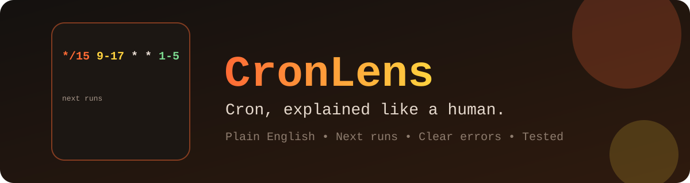
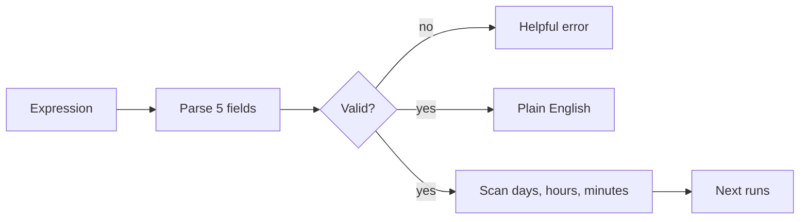

<p align='center'></p>

# CronLens ⏰

**Cron expressions, explained like a human.** Paste one, read what it means in plain English, and see exactly when it will run next. 🔍

No accounts, no build step, no dependencies. Everything runs in your browser.

## ✨ What you get

- 💬 **Plain-English summary**, like "At 09:30, on Monday through Friday"
- 🧩 **Field-by-field breakdown** of minute, hour, day of month, month and day of week
- 🕛 **Next 10 runs** in your own time zone, with a relative time for each
- 🚨 **Clear errors**, like "Minute must be between 0 and 59, got 61"
- 🧁 **8 one-click examples**, a cheat sheet, and a copy button
- 🧠 Supports lists, ranges, steps (`*/15`, `10-30/5`), month and weekday names, `7` as Sunday and shortcuts such as `@daily`
- 🌙 **Dark and light themes**, keyboard friendly, reduced-motion aware

## ✅ Tested

The parser lives in `cron.js` with its own tests:

```bash
node cron.test.js
```

They cover next-run calculation (weekends, leap days, month names, shortcuts), the classic day-of-month OR weekday rule, the plain-English descriptions, and the error messages.

## 🚀 Run it

```bash
git clone https://github.com/CyberLoop-dev/cronlens.git
cd cronlens
python3 -m http.server 8000   # or just open index.html
```

## 🧭 How it works



## 📁 Project structure

```text
cronlens/
├── index.html
├── styles.css
├── app.js          # interface
├── cron.js         # parser, describer, scheduler (no DOM)
├── cron.test.js    # tests
└── assets/         # logo and README banner
```

## ⚠️ Known limitations

- Standard 5-field cron only. Seconds, years and extensions like `L`, `W` or `#` are not supported.
- Next runs use your browser's local time and ignore daylight-saving edge cases.
- Different cron daemons differ in small ways, so check yours for exotic expressions.

## 💡 Ideas for later

- Choose a time zone
- Reverse mode: describe a schedule, get a cron expression
- Seconds and `L`/`W` support

## 🤝 Contributing

Issues and pull requests are welcome. Please run the tests first.

## 📄 License

[MIT](LICENSE)
